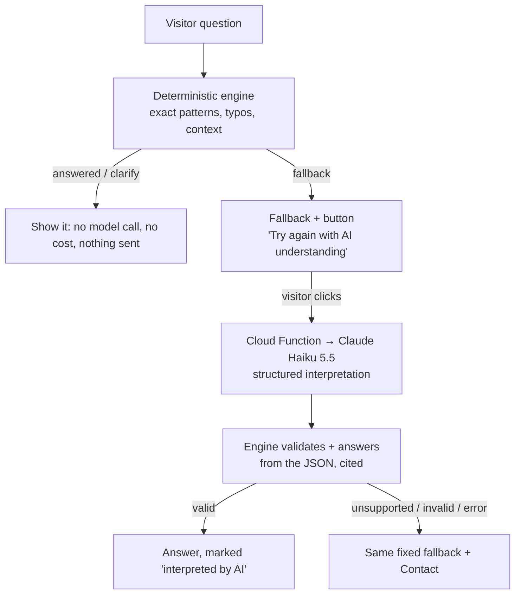
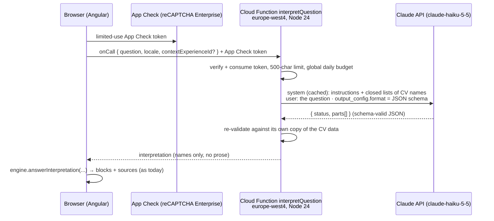

# CV Assistant: hosted language-model interpreter (option 3A), scoped plan

Status: proposal for review; nothing below is implemented. Prices were checked on 25 October 2026 (sources in §10). Recheck them, and the repository, before starting.

This plan extends the deterministic CV Assistant described in [`docs/cv-assistant.md`](docs/cv-assistant.md) and [`docs/cv-assistant-design.md`](docs/cv-assistant-design.md). Read those first.

## 1. Objective and the one rule that does not change

Let visitors ask about the CV in their own words (any phrasing, typos, several questions at once, other languages) by adding a hosted language model that **only interprets** the question.

The model never writes an answer. It returns a structured interpretation: intent, CV names chosen from closed lists, follow-up relation. The existing engine then resolves those names exactly, composes the answer from the fixed templates and the JSON, and cites the sources, exactly as today. So the guarantees in the design doc still hold:

- no invented facts;
- every fact traceable to a JSON pointer;
- the fixed fallback for anything unsupported;
- the fixed fallback when the interpreter is unavailable.

What does change, and needs your explicit approval:

- **Questions leave the browser.** That needs a privacy notice (§7).
- **There is a per-question cost**, small but nonzero (§6).
- **There is new infrastructure**: a Firebase Cloud Function, a secret, a billing account, and monitoring.

## 2. When the model is called

**Recommended: deterministic first, model on demand.**



- The model is called **only after** the deterministic engine falls back, and **only when the visitor clicks** "Try again with AI understanding" on that fallback. The click is the consent for that one question (§7) and also caps cost and abuse.
- **Alternative A, automatic**: call the model on every fallback, with a standing notice instead of per-question consent. It's smoother, but every unsupported question is sent and costs money. Under the GDPR this needs a clear notice before the first question; the click-to-send variant avoids that ambiguity.
- **Alternative B, model-first**: call the model for every question. It's the most natural, but sends everything and costs on every question, and the offline engine becomes only a backup. Not recommended for a personal site.

Decision needed: recommended, A or B (§11, question 1).

## 3. Architecture



### 3.1 Cloud Function (`functions/src/interpret-question.ts`, new)

- **Runtime and type**: Firebase Cloud Functions (2nd gen), `onCall`, TypeScript, Node 24 (matches `.nvmrc`). Calls Claude through the official `@anthropic-ai/sdk` package.
- **Region**: `europe-west4` (Netherlands), close to the site owner and most visitors.
- **Callable options**:
  - `enforceAppCheck: true` and `consumeAppCheckToken: true`, so each call needs a fresh limited-use token and a captured token can't be replayed;
  - `maxInstances: 2` and `concurrency: 20`, which bounds the worst-case spend rate;
  - `timeoutSeconds: 15`, `memory: 256MiB`.
- **Secret**: `ANTHROPIC_API_KEY`, defined with `defineSecret` (Secret Manager). It never reaches the browser, the repo or a log.
- **CV data**: the function bundles its own copy of `src/assets/data/*.json` at deploy time and builds the closed name lists from it. It never trusts lists sent by the client.
- **Logs**: no question text, no IP address. Only counters: interpreted / unsupported / invalid / error, plus latency, token usage and cost.
- **Global budget**: a daily request counter (a single Firestore document, holding no personal data). Above `DAILY_LIMIT` (default 300) the function returns `resource-exhausted` and the client shows the normal fallback.
- **Kill switch**: the `ASSISTANT_INTERPRETER_ENABLED` parameter. When off, the client hides the button. This is also a client flag in `environment*.ts`.

### 3.2 Model request

```ts
// Sketch: verify field names against the SDK docs when implementing.
const response = await client.messages.create({
  model: "claude-haiku-5-5",
  max_tokens: 1024,
  thinking: { type: "disabled" },          // allowed on Haiku 5.5 at effort high or below
  output_config: { effort: "low", format: { type: "json_schema", schema: INTERPRETATION_SCHEMA } },
  cache_control: { type: "ephemeral" },    // caches the stable system prompt (> 512-token minimum)
  system: SYSTEM_PROMPT,                   // instructions + closed name lists; stable between deploys
  messages: [{ role: "user", content: question }]
});
```

- **Stop reasons**: a `refusal` or `max_tokens` stop means unsupported. Haiku 5.5 has no server-side refusal fallback, and the output may not match the schema in those cases.
- **Prompt caching**: the system prompt must be byte-stable, with no dates and sorted lists. The question goes last, after the cache breakpoint.

### 3.3 Interpretation schema (closed lists, built from the data)

```jsonc
{
  "status": "supported" | "unsupported" | "needs_clarification",
  "parts": [                                   // at most 3 sub-questions
    {
      "intent": "profile" | "employers" | … | "socialLinks",        // the 17 existing IntentIds
      "company":    "Swisscom AG" | "QAT Global" | … | null,       // exact companyName values
      "technology": "Java" | "Javascript" | … | null,              // exact technologies values
      "post":       "post-0" | … | "post-9" | null,                // index into posts.json, not free text
      "network":    "LinkedIn" | "GitHub" | "Facebook" | null,
      "topic":      string | null,                                 // post search words only, max 6
      "relation":   "same" | "previous" | "next" | null            // follow-up to contextExperienceId
    }
  ]
}
```

- `additionalProperties: false` and `required` lists on every object, as the API requires.
- Enums contain only current data values, so the schema changes with the data. The first request after a change pays a one-time grammar compilation; compiled grammars are cached for 24 hours.
- The model **cannot** express a fact: there is no free-text answer field. The one free string, `topic`, is matched by the existing whole-word post search and never displayed as a fact.

### 3.4 Client changes

- `engine/assistant-engine.ts`: new `answerInterpretation(parts, locale, snapshot, context)`.
  - It maps each part to an `Interpretation` through **exact** name resolution: no aliases, no fuzzy matching, no patterns. Then it runs the existing `composeAnswer` and the provenance path.
  - Any name that doesn't resolve exactly, or a missing fact, falls back for that part.
- **Several parts**: answer each supported part in its own answer block group, and show the fallback for the rest. This deliberately reverses the v1 "no partial answers" rule, and it is visible to the visitor. The decision is §11, question 3.
- **UI**:
  - the button on the fallback;
  - a "Interpreting your question…" status;
  - a small "Interpreted by AI · answer from the CV" label on interpreted answers.
  - Errors, timeouts, the budget limit and the kill switch all show the existing fallback.
- **Session**: the button sends the fallback's own question text once, and only that question; there is no history. `contextExperienceId` is sent only when the deterministic context exists.

## 4. Safety

| Risk | Control |
| --- | --- |
| Invented or wrong facts | The model returns names from closed lists; the engine resolves them exactly and builds the answer from the JSON; the existing grounding tests apply unchanged |
| Prompt injection ("ignore the rules…") | Structured output with enums: the worst case is a wrong but valid intent, which still answers from the CV and shows its sources; no tools, no browsing, no free-text output; the question is a user message, never instructions |
| Abuse and cost runaway | App Check limited-use tokens, the 500-character limit, `maxInstances`, a daily global counter, an Anthropic workspace spend limit (e.g. $5/month), a Google Cloud budget alert, the kill switch |
| Key leak | Secret Manager only; the key is scoped to a dedicated Anthropic workspace with its own spend limit |
| Outage or latency | 15 s timeout → fallback; the offline engine is unaffected |
| Logging personal data | No question text or IP in logs or Firestore; only counters |

## 5. Deliverables and order

| # | Deliverable | Acceptance |
| --- | --- | --- |
| E1 | **Decisions and accounts**: choose §2 mode; Firebase project on Blaze; dedicated Anthropic workspace with spend limit; Google Cloud budget alert | Settings screenshots/notes in `DEPLOYMENT.md` |
| E2 | **Interpretation schema + `answerInterpretation`** (client, pure) | Unit tests: every intent from a hand-written interpretation answers with the same blocks/sources as its canonical question; unknown or forged names fall back |
| E3 | **Cloud Function** with App Check, validation, budget counter, kill switch, Claude call | Emulator tests with a stubbed Claude client: schema-invalid, refusal, timeout, over-budget and missing-App-Check paths all return the documented errors; no question text in logs |
| E4 | **Prompt and closed lists**, built from the bundled JSON at deploy | Unit test that the lists equal the snapshot's names; prompt is byte-stable across builds |
| E5 | **Evaluation set** (run against the real API; costs money, needs approval) | About 150 EN/PT questions: paraphrases of every intent, typos, compound questions, follow-ups, other languages, unsupported and adversarial ones (salary, "invent", injection). Report intent accuracy, false-supported rate on unsupported questions (target 0 that answer with a wrong fact), latency p50/p95, cost per question |
| E6 | **UI** (button, status, label, errors) and privacy notice (§7) in both XLF files | Playwright with the function stubbed: consent click sends exactly one request with only the question; no request without a click; errors fall back |
| E7 | **Docs + rollout**: update the docs, deploy behind the flag, enable after E5 passes | Monitoring dashboard of counters; rollback = flag off |

Estimated effort: about 3–5 days of implementation plus the evaluation run.

## 6. Cost estimate

### 6.1 Per question (Claude Haiku 5.5, checked 25 Oct 2026)

| Item | Tokens | Price | Cost |
| --- | --- | --- | --- |
| System prompt: instructions + name lists (cache hit) | ~1,500 | $0.01 / MTok cache read | $0.000015 |
| Question + context (uncached) | ~200 | $0.10 / MTok input | $0.000020 |
| Interpretation JSON | ~80 | $0.50 / MTok output | $0.000040 |
| **Per question, cache hit** | | | **≈ $0.00008** |
| Per question, cache miss (5-min write at $0.125 / MTok) | | | ≈ $0.00025 |

Cache entries last 5 minutes, so on a low-traffic site many requests will miss. **Budget with $0.00025 per question.**

### 6.2 Per month

| Volume / month | Claude | Cloud Functions | App Check (reCAPTCHA) | Total (approx.) |
| --- | --- | --- | --- | --- |
| 1,000 interpreted questions | $0.25 | $0 (free tier) | $0 (free tier) | **≈ $0.25** |
| 10,000 | $2.50 | $0 | $0 (at the 10,000 free limit) | **≈ $2.50** |
| 100,000 (abuse scenario) | $25 | ≈ $0 (still within 2M invocations / 400K GB-s) | beyond the free tier: price to confirm | capped by the daily limit (300/day ≈ 9,000/month) and the Anthropic spend limit |

Notes:

- **Cloud Functions**: each call is about 1–2 s at 256 MiB, roughly 0.5 GB-s, so the free 400K GB-seconds cover about 800K calls a month. Cloud Functions require the Blaze (pay-as-you-go) plan, with a billing account attached.
- **reCAPTCHA Enterprise**: `consumeAppCheckToken` makes each question one assessment. The first 10,000 a month are free. I could not verify current paid rates (a 2024 notice reported $1 per 1,000 above the free tier), so confirm them before enabling.
- **Secret Manager**: one secret and its accesses, a few cents a month at most; confirm on the pricing page.
- **US-only inference**: if `inference_geo: "us"` were required it costs 1.1×. The default global routing is standard price.

**Bottom line:** at realistic personal-site traffic this is under $1 a month. The safeguards keep the worst case to a few dollars.

## 7. Privacy notice (draft)

These drafts assume the recommended click-to-send mode. They need your review. The retention statement in particular must match the Anthropic terms that apply to your account at the time; I did not verify a specific retention period.

### 7.1 Button and inline notice (UI, both XLF files)

**EN**

- Button: **Try again with AI understanding**
- Note under the button: "Sends only this question to Google Cloud and Anthropic to interpret it. The answer still comes from my CV. [How this works]"
- Label on interpreted answers: "Interpreted by AI · answer from my CV"

**PT**

- Botão: **Tentar de novo com interpretação por IA**
- Nota: "Envia apenas esta pergunta ao Google Cloud e à Anthropic para interpretá-la. A resposta continua vindo do meu currículo. [Como funciona]"
- Rótulo: "Interpretado por IA · resposta do meu currículo"

### 7.2 "How this works" (short page or panel)

**EN**

> **CV Assistant: how your question is handled**
>
> The CV Assistant answers from the information published in this CV. Most questions are answered entirely in your browser: nothing is sent anywhere.
>
> If the assistant can't understand a question, you can choose **Try again with AI understanding**. Only then, that single question (up to 500 characters, plus a reference to the role you were just asking about, if any) is sent to:
>
> - **Google Cloud (Firebase), Netherlands region:** runs the small service that forwards the question. A security check (Firebase App Check with Google reCAPTCHA Enterprise) confirms the request comes from this website.
> - **Anthropic (Claude API):** a language model reads the question and returns which CV topic it is about (for example "technologies used at a company"). It does not write the answer.
>
> The answer you see is then assembled from the CV data, with links to its sources, exactly like other answers.
>
> What is not sent: your earlier questions and answers, your name or contact details, cookies or browsing history. The question text is not stored by this website and not written to its logs; only anonymous counts (how many questions were interpreted) are kept.
>
> Anthropic processes the question to provide the service under its commercial terms. **[Retention: state the period that applies to the account, e.g. "Anthropic may retain API inputs and outputs for up to N days", or "not retained" if zero data retention applies.]** Google processes the request under the Google Cloud terms. Anthropic's processing may take place outside the European Economic Area.
>
> Please don't include personal or confidential information in your questions. To contact me directly, use the [contact form](#contact).
>
> Controller: Guilherme Borges Bastos. Questions about this notice: **[contact email]**.

**PT**

> **Assistente do CV: como sua pergunta é tratada**
>
> O Assistente do CV responde com as informações publicadas neste currículo. A maioria das perguntas é respondida inteiramente no seu navegador: nada é enviado a lugar nenhum.
>
> Se o assistente não entender uma pergunta, você pode escolher **Tentar de novo com interpretação por IA**. Só então essa única pergunta (até 500 caracteres, mais uma referência ao cargo sobre o qual você acabou de perguntar, se houver) é enviada para:
>
> - **Google Cloud (Firebase), região dos Países Baixos:** executa o pequeno serviço que encaminha a pergunta. Uma verificação de segurança (Firebase App Check com Google reCAPTCHA Enterprise) confirma que a solicitação vem deste site.
> - **Anthropic (API do Claude):** um modelo de linguagem lê a pergunta e indica a qual tema do currículo ela se refere (por exemplo, "tecnologias usadas em uma empresa"). Ele não escreve a resposta.
>
> A resposta que você vê é então montada a partir dos dados do currículo, com links para as fontes, exatamente como as outras respostas.
>
> O que não é enviado: suas perguntas e respostas anteriores, seu nome ou dados de contato, cookies ou histórico de navegação. O texto da pergunta não é armazenado por este site nem gravado nos registros; apenas contagens anônimas (quantas perguntas foram interpretadas) são mantidas.
>
> A Anthropic processa a pergunta para prestar o serviço, conforme seus termos comerciais. **[Retenção: informar o período aplicável à conta.]** O Google processa a solicitação conforme os termos do Google Cloud. O processamento pela Anthropic pode ocorrer fora do Espaço Econômico Europeu.
>
> Não inclua informações pessoais ou confidenciais nas perguntas. Para falar comigo diretamente, use o [formulário de contato](#contact).
>
> Responsável: Guilherme Borges Bastos. Dúvidas sobre este aviso: **[e-mail de contato]**.

### 7.3 Documentation changes when this ships

- `docs/cv-assistant.md` and `docs/cv-assistant-design.md`: replace "nothing leaves the browser" with "nothing leaves the browser unless the visitor chooses AI understanding for a question".
- Add the function, the secret, the flag and the budget settings to `DEPLOYMENT.md`.

## 8. Testing and release gate

- **All existing unit and e2e tests stay green.** The offline engine's behavior is unchanged with the flag off.
- **New unit tests**: E2 and E4. **Function tests**: E3 in the Firebase emulator, with a stubbed Claude client and no real calls in CI.
- **E2E**: function stubbed through the existing Playwright fixture approach (third-party traffic stays blocked). Tests must show:
  - no interpreter request without a click;
  - exactly one request, containing only the question, after a click;
  - an interpreted answer has sources;
  - errors fall back;
  - the question text appears in no log or URL.
- **Evaluation (E5)**: run before enabling, with an approved budget (about 150 questions ≈ $0.04). Release only if:
  - no unsupported or adversarial question produces an answer with a wrong fact;
  - intent accuracy is at least 90% on the paraphrase set.

## 9. Out of scope

- The model writing answer text (option 3B).
- Storing conversations.
- Accounts.
- Analytics on question content.
- Any other model provider.

## 10. Sources (checked 25 October 2026)

- [Claude API pricing](https://platform.claude.com/docs/en/about-claude/pricing): Haiku 5.5 rates, cache multipliers, prompts over 100K tokens.
- [Claude API rate limits](https://platform.claude.com/docs/en/api/rate-limits): tiers, spend caps, own spend limit, workspace limits.
- [Structured outputs](https://platform.claude.com/docs/en/build-with-claude/structured-outputs): Haiku 5.5 support, schema limits, grammar cache.
- [Cloud Run pricing](https://cloud.google.com/run/pricing) and [Google Cloud Free Program](https://docs.cloud.google.com/free/docs/free-cloud-features): functions free tier.
- [Firebase pricing](https://firebase.google.com/pricing) and [Firebase pricing plans](https://firebase.google.com/docs/projects/billing/firebase-pricing-plans): Blaze requirement.
- [Cloud Functions version comparison](https://firebase.google.com/docs/functions/version-comparison).
- [App Check overview](https://firebase.google.cn/docs/app-check?hl=ko) and [App Check for web](https://firebase.google.com/docs/app-check/web?hl=he): 10,000 free reCAPTCHA Enterprise assessments per month.

## 11. Decisions needed

1. Trigger mode: click-to-send after a fallback (recommended), automatic on fallback, or model-first.
2. Model: Claude Haiku 5.5 (recommended for cost and latency). Opus 5.5 is the general default, but at about 40× the input price it is unnecessary for classification.
3. Compound questions: answer the supported parts and show the fallback for the rest (recommended), or keep v1's all-or-nothing rule.
4. Retention wording: confirm which Anthropic data-retention terms apply to the account, and the contact email for the notice.
5. Limits: the daily request limit (default 300), the Anthropic workspace spend limit (suggest $5/month) and the Google Cloud budget alert threshold.
