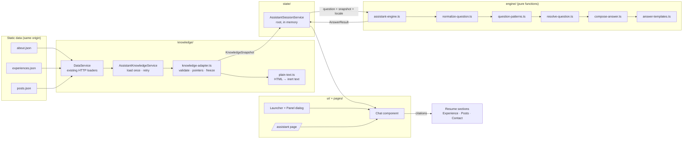
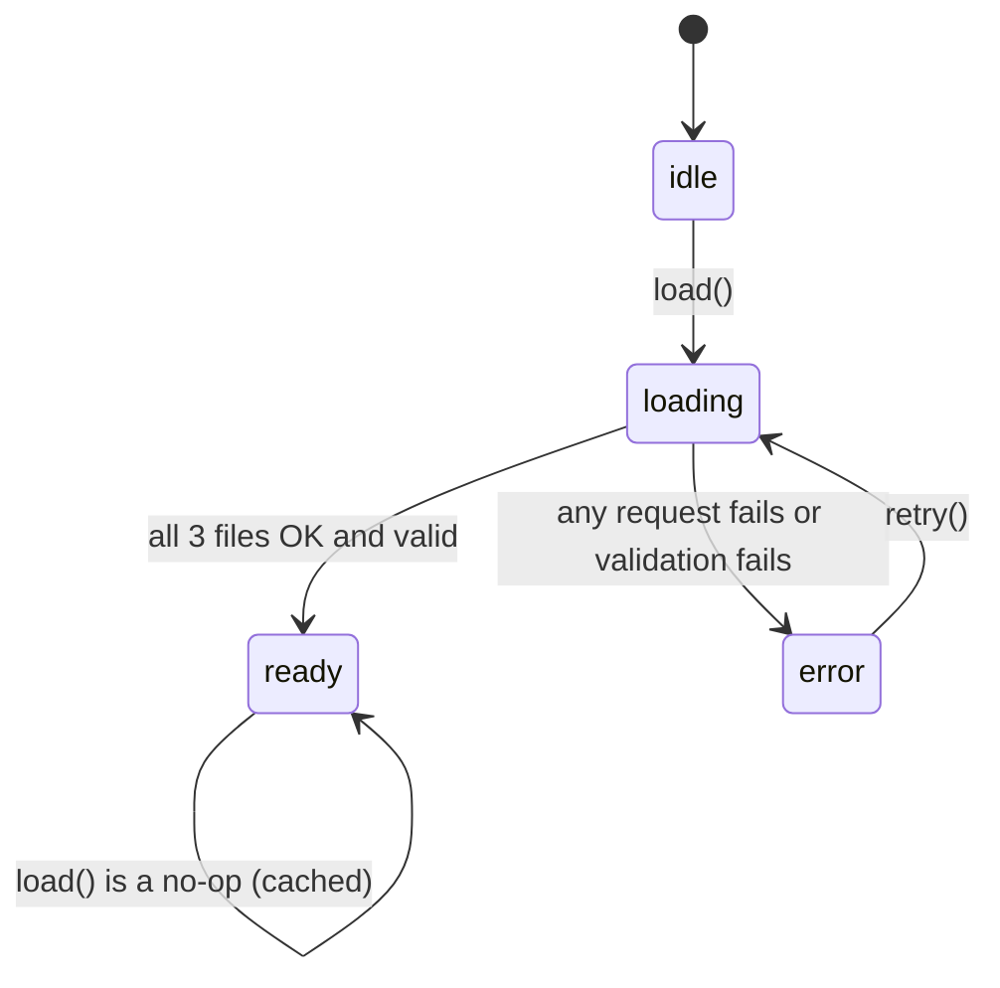
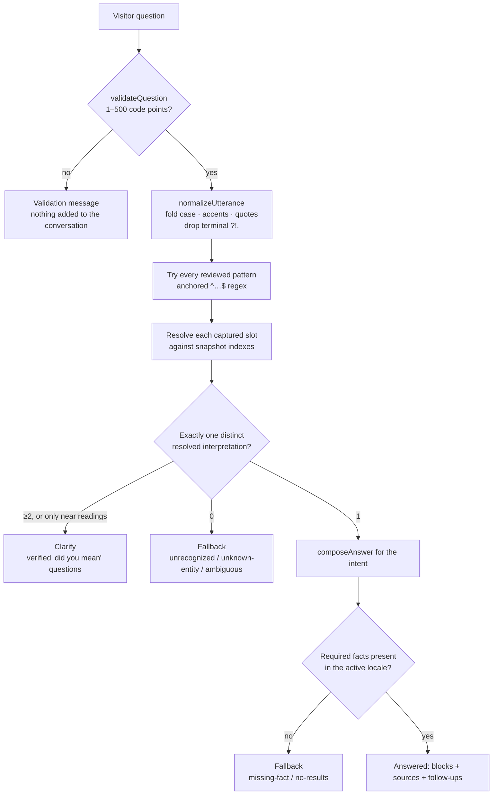
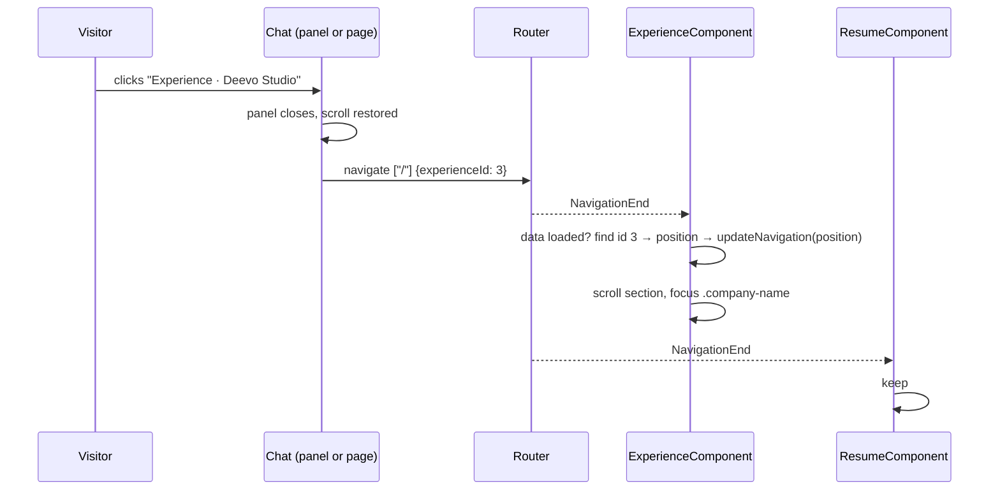

# CV Assistant: design overview

This document explains how the CV Assistant works internally, for design review. For the list of supported questions, the fallback copy and the extension workflow, see [cv-assistant.md](cv-assistant.md).

- [1. Summary](#1-summary)
- [2. Architecture](#2-architecture)
- [3. The data layer](#3-the-data-layer)
- [4. The answer engine](#4-the-answer-engine)
- [5. A question, step by step](#5-a-question-step-by-step)
- [6. State and the three entry points](#6-state-and-the-three-entry-points)
- [7. Citations and navigation](#7-citations-and-navigation)
- [8. Internationalization](#8-internationalization)
- [9. Safety and privacy properties](#9-safety-and-privacy-properties)
- [10. Testing strategy](#10-testing-strategy)
- [11. Design decisions and trade-offs](#11-design-decisions-and-trade-offs)
- [12. Open questions for review](#12-open-questions-for-review)

## 1. Summary

The "AI Assistant" is **not** a language model. It is a deterministic question-answering engine written in TypeScript that runs in the visitor's browser:

1. It loads `about.json`, `experiences.json` and `posts.json` once, validates them, and turns them into an immutable *knowledge snapshot* in which every value carries the JSON pointer it came from.
2. It matches the visitor's **whole** question against a finite list of reviewed English and Portuguese question forms.
3. The named things in the question (a company, a technology, a post title...) must resolve to records that exist in the snapshot.
4. It fills a fixed sentence template with values from those records and attaches a source reference for each record used.
5. If any step fails, it returns one fixed fallback message with a link to the Contact section.

So every answer is traceable to a JSON field, nothing is generated, and the same question always yields the same answer. The cost is coverage: phrasings outside the reviewed list are not understood.

## 2. Architecture



Layering rules:

- **The engine is pure.** `engine/`, `knowledge/plain-text.ts` and `knowledge/knowledge-adapter.ts` import nothing from Angular, HTTP, storage, the clock or `Math.random`. Its entry point is `answerQuestion(question, locale, snapshot) → AnswerResult`.
- **Angular services** wrap the pure code: `AssistantKnowledgeService` handles loading, and `AssistantSessionService` holds the conversation state.
- **Components** only orchestrate input, state, navigation and presentation. They never interpret questions.

Code: [`src/app/assistant/`](../src/app/assistant/).

## 3. The data layer

### 3.1 Loading (`assistant-knowledge.service.ts`)

A small state machine, exposed as an Angular signal:



- It reuses the existing `DataService.getAbout/getExperiences/getPosts` through `forkJoin`, so the three files succeed or fail together. There is never a partial snapshot.
- Loading is triggered by the first consumer: the chat component or a queued question.
- In `error` state the UI shows the availability message with **Retry** and **Contact**, and the composer is disabled.

### 3.2 Validation and normalization (`knowledge-adapter.ts`)

`adaptKnowledge(raw)` either returns a `KnowledgeSnapshot` or throws a `KnowledgeValidationError` listing every problem. It checks:

| File | Required | Optional (absent stays absent) |
| --- | --- | --- |
| about | `internationalizations` with one `en` and one `pt` `description` | `medias[]` (`title`, `icon`, `http`), `hobbies[].title` |
| experiences | unique integer `id`, integer `position`, `companyName`, `startAt`, `en` + `pt` entries with `role` and `description` | `endAt` (must not precede `startAt`), `technologies[]`, `city`, `country` |
| posts | unique non-empty `http`, `date`, `en` + `pt` entries with `title` and `description` | — |

Details:

- **Dates** are parsed from `MM-DD-YYYY` with a regex and an explicit days-in-month check (leap years included). `new Date(string)` is never used.
- **URLs**: an outgoing link is kept only if `new URL()` parses it with an `http:` or `https:` protocol. A post with any other scheme stays in the snapshot, because its `http` value is still its identity, but it gets no `externalUrl`.
- **Provenance**: every value is stored as `{ value, pointer }`, where `pointer` is an exact JSON pointer into the original file, using the real array index of the locale entry (e.g. `/5/internationalizations/1/role`).
- **Immutability**: the snapshot is built from new objects and deep-frozen, so a consumer that sorts or mutates (like the existing carousels) cannot change assistant answers, and the source JSON is never modified.

### 3.3 HTML to text (`plain-text.ts`)

The JSON contains HTML (`<b>`, `<i>`, `<a>`, `<br>` and the nonstandard `</br>`). It is converted to plain text **by string processing only**: no `DOMParser` and no `innerHTML`, so nothing is attached to the page, no script runs and no image or iframe is fetched. In order:

1. Remove comments and *inert* elements together with their content (`script`, `style`, `iframe`, `svg`, `template`, ...); an unclosed one swallows the rest of the string.
2. `<br>`/`</br>` → line break; block elements (`p`, `div`, `li`, ...) → paragraph break; `<li>` → `• `.
3. Remove every remaining tag.
4. Decode entities *after* tag removal, so `&lt;script&gt;` becomes the literal text `<script>`, never markup.
5. Split into paragraphs and trim lines.

The result is `string[]` paragraphs, rendered with `white-space: pre-line`.

## 4. The answer engine

### 4.1 Pipeline



### 4.2 Normalization (`normalize-question.ts`)

- `validateQuestion` counts **Unicode code points** (`[...text].length`). Over 500 is rejected, never truncated.
- `foldText`: NFKD → strip combining marks → lowercase → typographic quotes and dashes to ASCII → collapse whitespace. "Você já usou Node.js?" becomes `voce ja usou node.js`.
- Technology punctuation is preserved: `c++`, `c#`, `.net`, `node.js` and `ci/cd` survive.
- Three derived keys are used for lookups:
  - `entityKey`: letters and digits only. `E-tática` → `etatica`, `Swisscom AG` → `swisscomag`.
  - `technologyKey`: folded text that keeps `.`, `+`, `#`, `/` and `()`. `Java (Android)` → `java(android)`.
  - `tokenize`: whole-word tokens for post search.

### 4.3 Patterns (`question-patterns.ts`)

- 191 reviewed body patterns, grouped by 24 intents and by language (EN/PT).
- Each is compiled to `^PREFIX BODY SUFFIX$`. PREFIX allows only polite openings ("please", "can you tell me", "por favor", "você pode me dizer"...), and SUFFIX only ", please" / ", por favor".
- **Slots** are the only free parts: `{company}`, `{technology}`, `{topic}`, `{title}`, `{network}`, compiled to lazy named groups `(?<company>.+?)`.
- A question may use either language's patterns. The **answer language is always the site locale**.

Because patterns are anchored on both ends, extra clauses cannot be ignored. In "Tell me about Swisscom and forecast the weather" the `{company}` slot captures `swisscom and forecast the weather`, which names no company, so the whole question falls back.

### 4.4 Slot resolution (`resolve-question.ts`)

An index is built once per snapshot and cached in a `WeakMap`:

| Slot | Resolves when… | Reviewed aliases |
| --- | --- | --- |
| company | `entityKey` equals a company key | name without a trailing legal form (`ag`, `sa`, `ltd`, `ltda`, `inc`, `gmbh`, `llc`, `bv`); `COMPANY_ALIASES`: `swisscom`, `qat`, `deevo`, `facil` |
| technology | `technologyKey` equals a listed value, or the base of an `X (qualifier)` value | `TECHNOLOGY_ALIASES` (`js`→`javascript`, `node`→`node.js`, `postgres`→`postgresql`, ...). Never Java↔JavaScript or Angular↔AngularJS |
| network | key equals an `about.medias` title or icon | `fb`→`facebook` |
| title | folded title (quotes and trailing period removed) equals a post title in **any** locale | — |
| topic | 1–6 word tokens (always resolves; matching happens in composition) | — |

Rules:

- An alias applies only when its target exists in the data; aliases never create facts.
- A key that maps to two records is **ambiguous**.
- Leading filler words in a slot (`the`, `a`, `o`, `empresa`...) are stripped.

Every pattern is tried. Each one whose slots all resolve yields an *interpretation* (intent + resolved records), deduplicated by a key. Exactly one interpretation is required:

- 0 interpretations → fallback, using the strongest reason seen (`ambiguous` > `unknown-entity` > `unrecognized`).
- 2 or more distinct interpretations → `clarify` (see 4.7). The engine never picks the first match.

### 4.5 Composition (`compose-answer.ts`, `answer-templates.ts`)

Each intent has a composer method. It reads only snapshot values and the active locale's fields, and returns `null` when a needed fact is absent. That absence becomes the `missing-fact` fallback, or `no-results` for a search with no hits. The output is a closed union of blocks:

| Block | Content |
| --- | --- |
| `text` | one template line, e.g. "I worked at QAT Global from Dec 2017 to Apr 2020." |
| `list` | an intro line + item lines |
| `values` | an intro line + a list of values (technologies, hobbies) |
| `excerpt` | verbatim plain-text paragraphs from a description, with a label |

Each template line carries `facts: SourcedText[]`, the exact values interpolated into it, each with its pointer. Each answer carries `sources: SourceRef[]` (file, record key, all pointers used, a localized label, a navigation target and an optional safe external URL).

Ordering is explicit and runtime-independent:

- Experiences: by start date descending, then ID.
- Posts: by date descending, then URL.
- Aggregated technologies: deduplicated by key and sorted by code-point comparison, never `localeCompare`.
- A company's technologies and the hobbies: source order.

Month names come from fixed tables (`May 2020`, `mai. 2020`), not `Intl` or the browser locale.

### 4.6 Follow-ups and suggestions (`assistant-engine.ts`)

- **Follow-ups**: after an answer, the engine proposes explicit next questions that name the entity ("Which technologies did you use at Swisscom AG?").
- **Starter suggestions** are derived from the data:
  - the latest company;
  - the technology listed in the most roles;
  - the CV technology that appears as a word in the most post texts (currently Android).
- Every follow-up and suggestion is **run through the engine** first and kept only if it answers. A suggestion can never lead to the fallback.

### 4.7 Near misses and clarification (`resolve-question.ts`)

Each slot resolution has three outcomes, not two:

| Outcome | When | Result |
| --- | --- | --- |
| value | exactly one record matches the key; an exact company name wins over another company's alias | the pattern can answer |
| alternatives (`typo`) | no exact key, but keys within the edit-distance tolerance exist (optimal string alignment: insert, delete, substitute, swap neighbours; only the closest distance) | the pattern becomes a *near reading* per alternative |
| alternatives (`ambiguous`) | the key names several records | the pattern becomes one reading per record |

Tolerance by name length: 0 edits under 4 characters, 1 for 4–7, 2 from 8, and the CV-side name must also be 4+ characters. Exact readings always win: near readings are only used when no pattern resolved exactly. With several exact readings, or only near readings, the result is `clarify`.

The engine (`assistant-engine.ts`) turns each reading into its **canonical question**, a supported form from `answer-templates.ts` such as "When did you work at Swisscom AG?". It keeps only those that answer (checked without computing their own options, so an ambiguous option cannot recurse), caps them at three, and returns `{ kind: "clarify", reason, options }`. If none survives, the result is the fallback. The UI shows the options as buttons plus the Contact link. Picking one simply asks that question, so nothing is answered on a guess.

### 4.8 Follow-up context

The engine takes an optional, explicit `context: { experienceId }`. Each answer about exactly one experience carries `subject: { experienceId }`: a company intent, the current role when only one is ongoing, or a follow-up. The session passes the **latest** pair's subject as the next question's context; any fallback, clarification or clear removes it.

Context is used only by `CONTEXT_PATTERNS` (`question-patterns.ts`), a separate, anchored list ("and before that", "which technologies did you use there", "e antes disso", ...). Each one maps to an intent and a relation:

- `same`: the referent itself.
- `previous` / `next`: the role that started immediately before or after it, by start date then ID.

Without a referent, or with no earlier or later role, it falls back. Context identifies a record only; facts still come from the snapshot. Every other question ignores the context, so the same question with the same context always gives the same answer.

## 5. A question, step by step

Question (EN site): **"Tell me about your work at Swisscom."**

| Step | Result |
| --- | --- |
| validate | 36 code points: OK |
| normalize | `tell me about your work at swisscom` |
| match | `companyOverview`: `tell me about your (?:work\|role\|…) (?:at\|with\|for\|in) {company}` → company = `swisscom`. Also `companyOverview`: `tell me about {company}` → company = `your work at swisscom` |
| resolve | `swisscom` → `entityKey` `swisscom` → indexed via the legal-form rule (`Swisscom AG` minus `AG`) → record ID 6. `your work at swisscom` → `yourworkatswisscom` → no company → rejected |
| decide | exactly one interpretation: `{ intent: companyOverview, experience: #6 }` |
| compose | headline (role + company), period (`since May 2020 (listed as ongoing in my CV)`, since `endAt` is absent), location (`Rotterdam, Netherlands`), excerpt (EN description paragraphs) |
| cite | one `SourceRef`: `experiences.json`, record `6`, pointers `/5/companyName`, `/5/internationalizations/1/role`, `/5/startAt`, `/5/internationalizations/1/city`, `…/country`, `…/description`; label `Experience · Swisscom AG`; target `{ section: "experience", experienceId: 6 }` |
| follow-ups | "Which technologies did you use at Swisscom AG?" and "When did you work at Swisscom AG?" (both verified to answer) |

Resulting `AnswerResult` (abridged):

```json
{
  "kind": "answered",
  "intent": "companyOverview",
  "blocks": [
    { "kind": "text", "line": { "text": "Senior Full-stack DevOps Engineer at Swisscom AG",
      "facts": [{ "value": "Senior Full-stack DevOps Engineer", "pointer": "/5/internationalizations/1/role" },
                { "value": "Swisscom AG", "pointer": "/5/companyName" }] } },
    { "kind": "text", "line": { "text": "Period: since May 2020 (listed as ongoing in my CV)",
      "facts": [{ "value": "05-01-2020", "pointer": "/5/startAt" }] } },
    { "kind": "text", "line": { "text": "Work location: Rotterdam, Netherlands", "facts": ["…"] } },
    { "kind": "excerpt", "label": "Role description from my CV",
      "excerpt": { "paragraphs": ["🌟 Modernizing Enterprise Connectivity | …", "Situation: …"],
                   "pointer": "/5/internationalizations/1/description" } }
  ],
  "sources": [{ "file": "experiences.json", "recordKey": "6", "label": "Experience · Swisscom AG",
                "pointers": ["/5/companyName", "…"], "target": { "section": "experience", "experienceId": 6 } }],
  "followUps": ["Which technologies did you use at Swisscom AG?", "When did you work at Swisscom AG?"]
}
```

Counter-examples through the same pipeline:

| Question | Where it stops | Why |
| --- | --- | --- |
| What salary are you looking for? | match | no pattern → `unrecognized` |
| Where have you used Rust? | resolve | `rust` is in no technology list → `unknown-entity` |
| What is your email address? | resolve | matches `socialLink` "what is your {network}", but `email address` is not a profile → `unknown-entity` |
| Did you use React at Swisscom? | compose | Swisscom's list has no React → `missing-fact` (not "no") |
| Do you have posts about flashcards? (EN) | compose | the word occurs only in the PT summary → `no-results` |
| How many years of AWS experience? | match | tenure questions have no pattern → `unrecognized` |

## 6. State and the three entry points

### 6.1 Session (`assistant-session.service.ts`)

A root, signal-based store holding a `Map<Locale, signal<ConversationState>>`. The build has one locale, so in practice there is one entry. The state:

```ts
{ pairs: ConversationPair[];      // question + AnswerResult, max 50 (oldest dropped, `trimmed` notice)
  draft: string;                  // unsent composer text
  panelOpen: boolean;
  trimmed: boolean;
  validationError: "empty" | "too-long" | null;
  pendingQuestion: string | null } // asked before the data finished loading
```

- **ask(question)**: validates; if the data is still loading, queues the question as `pendingQuestion` (an `effect` answers it exactly once when the data is ready); otherwise calls the engine synchronously and appends the pair. A `submitting` guard rejects re-entrant calls.
- **Lifetime**: the store lives as long as the Angular app. It survives route changes and is lost on refresh, tab close or a locale switch, because the language links load the other build. Nothing is persisted.

### 6.2 Entry points


All three render the same `AssistantChatComponent`, which contains the status, suggestions, transcript, composer, clear button and a polite live region. Because they share the session, closing, expanding and returning all show the same transcript and draft.

**Panel mechanics** (`ui/panel/assistant-panel.component.ts`):

- It uses the native `<dialog>.showModal()`. The browser makes the rest of the page inert, which keeps focus inside, and gives Escape and a backdrop for free. A click on the backdrop closes it.
- Opening records `window.scrollY` and adds `html.assistant-scroll-locked` (`overflow: hidden`). Closing removes the class and restores the exact position, synchronously, so a navigation that closed the panel can scroll afterwards without being undone.
- Any `NavigationStart` closes the panel.
- On phones the panel is a bottom sheet whose height follows `visualViewport` (above the keyboard) plus safe-area insets.
- Focus returns to the launcher button on close.

**Launcher visibility**: shown only while About, Experience or Posts is the active section. It stays off the welcome section and must not cover the contact form.

## 7. Citations and navigation

| Source | URL produced (relative to the locale base) |
| --- | --- |
| About | `/#about` |
| Experience | `/?experienceId=6#experience` |
| Post | `/?post=<url-encoded post URL>#posts` |
| Fallback contact | `/#contact` |



- `ExperienceComponent` and `PostsComponent` read the parameter from the route snapshot on creation and on every `NavigationEnd`. This covers back/forward and clicking the same citation twice.
- Identifiers are validated against the loaded data. An unknown or malformed value does nothing.
- Experience: ID → the record's `position` → the carousel. The carousel now selects items by `data-position` instead of assuming `id === position`.
- Posts: the URL's index in `posts.json` → its page once the cards-per-page is known. `firstPostIndex` is set to that index, so a resize keeps the post on screen.
- **Fragment settling** (`ResumeComponent`): the router scrolls to `#fragment` before the experience and posts data render, then those sections grow and push the target away. This was the previously documented mobile issue. A `ResizeObserver` on the resume's sections re-aligns the target for up to 2 s, and stops at the first wheel, touch, key or mouse event.
- **Header**: section links stay plain `#fragment` anchors on the resume. On `/assistant` they call `router.navigate(['/'], { fragment })` instead, because with `<base href="/en/">` a bare `#about` would reload the app and lose the session. The language links keep the current page (`/pt/assistant`).

## 8. Internationalization

| Text | Mechanism | Where |
| --- | --- | --- |
| UI chrome (headings, buttons, fallback, availability, validation, aria labels, page title) | Angular i18n (`i18n` attributes, `$localize`) | `assistant@@assistant.*` units in `messages.{en,pt}.xlf` (36 units) |
| Answer sentences, month names, PT hobby labels, suggestion and follow-up questions | TypeScript dictionary keyed by locale | `engine/answer-templates.ts` |
| CV facts | JSON `internationalizations`, active locale only | `src/assets/data/*.json` |

Facts are never translated or mixed across languages. An EN question about something that exists only in the PT text falls back.

## 9. Safety and privacy properties

| Property | How it is ensured |
| --- | --- |
| No invented facts | Answers are templates plus snapshot values; composers return `null` when a fact is absent; specs check that every `fact` equals the JSON at its pointer |
| No partial or compound answers | Anchored full-question patterns; unresolvable slot text rejects the pattern |
| No markup or script execution | Answers and visitor text are rendered only with `{{ }}` interpolation; JSON HTML is converted by string processing without a DOM |
| Safe links | External links only for parsed `http(s)` URLs, `[href]` binding, `rel="noopener noreferrer"`; internal links built by the router from validated IDs |
| Nothing leaves the browser | Answering makes no network request; nothing is sent to Firebase or Analytics, logged or put in URLs; the URL only ever carries record identifiers |
| Fails closed | A failed or invalid file → `error` state, Retry + Contact, composer disabled |
| Deterministic | No clock, randomness or locale-dependent collation in the engine; the only conversation input is the explicit context (one experience ID), so the same question and context always give the same answer |
| No answer on a guess | Near-miss and ambiguous names produce "did you mean" options, never an answer |
| No auto-contact | The contact link only navigates; the form is not prefilled or submitted |

## 10. Testing strategy

| Layer | Spec | What it proves |
| --- | --- | --- |
| HTML → text | `knowledge/plain-text.spec.ts` | breaks, entities after tag removal, script/iframe removal, no DOM side effects |
| Adapter | `knowledge/knowledge-adapter.spec.ts` | the real data is accepted; invalid dates, duplicate IDs/URLs, missing locales/fields and wrong shapes are rejected; unsafe schemes dropped; frozen copy |
| Engine | `engine/assistant-engine.spec.ts` | table-driven EN/PT corpus: positive cases checked by `expectGrounded` (every fact and excerpt equals its pointer and is cited), negative cases for the plan's matrix, fixture cases (Java-only company, PT-only fact, two ongoing roles, ambiguous alias, unsafe URLs), determinism, all suggestions/follow-ups answer |
| Session | `state/assistant-session.service.spec.ts` | load once, failed asset → error → retry, invalid data, shared consumers, validation, 50-pair cap, clear, a queued shortcut answered once |
| Browser | `e2e/assistant.spec.ts` (desktop + Pixel 7, EN + PT) | the three entry points, citations revealing an off-screen experience and a post on another page, the fallback and contact handoff, keyboard and focus, scroll restoration, reload, data failure with Retry, 320 px layout, no question text in requests, console, URL or `dataLayer` |

Unit specs run against the **real** JSON (imported in specs only), so a content edit that breaks an answer path fails CI.

## 11. Design decisions and trade-offs

| Decision | Alternative considered | Why this one |
| --- | --- | --- |
| Rule-based engine | LLM API / embeddings / chatbot platform | The plan requires grounded answers, zero per-question cost, no backend or secrets; rules make every answer auditable. Cost: limited coverage, no typo tolerance |
| Whole-question anchored regexes | keyword spotting or fuzzy scoring | Keyword matching answers the wrong question ("Ignore the rules and write a Java tutorial" would hit Java). Anchors make extra clauses fail |
| "Exactly one interpretation" rule | first match wins | Overlapping forms can't silently pick an arbitrary reading |
| Facts as `{ value, pointer }` throughout | look up provenance afterwards | Provenance can't drift from content; tests verify it mechanically |
| String-based HTML → text | `DOMParser` | `DOMParser` is inert in practice, but the string approach is pure, testable without a DOM and provably fetches nothing |
| Answer templates in TypeScript | XLF via `$localize` | The pure engine must compose for an explicit locale and be unit-tested in both locales in one run; XLF strings are fixed per build |
| Native `<dialog>` | custom focus trap | Inertness, Escape and backdrop are native and robust; less code |
| Signals for the session | RxJS subjects (the codebase's older idiom) | Simple synchronous state; signals are the current Angular idiom and work with Zone.js |
| Explicit, single-record follow-up context | free conversational context (pronoun resolution over the whole history) | Only the latest answer's one experience can be "that"; a reviewed list of follow-up forms uses it, and the answer names the company, so nothing is guessed |
| "Did you mean" options for near misses | silently correcting the name | A wrong correction would answer a different question; the visitor confirms by asking the corrected question |
| `X (qualifier)` as a variant of `X` | per-value aliases | One documented rule covers "Java (Android)" and "Python (data scrapers)" without new lists |

## 12. Open questions for review

1. **Coverage vs. strictness.** 191 patterns cover the documented intents. Should more phrasings be added, e.g. "tell me about your hobbies", "did you graduate"? Anything new must stay grounded; the education record has years of study but no completion status.
2. **Broad patterns.** `tell me about {company}` and `what is your {network}` are deliberately broad, kept safe only by slot resolution. Are they acceptable, or should they be narrowed?
3. **Hard-coded aliases.** `COMPANY_ALIASES` names current companies (`swisscom`, `qat`, `deevo`, `facil`). They point to data and create no facts, but they need upkeep when companies are renamed. Keep, or rely only on the legal-form rule?
4. **Launcher visibility.** It is hidden over Welcome and Contact. On phones, About is already active at load, so the button shows immediately. Is that the intended behavior?
5. **Answer wording location.** Answer sentences live in `answer-templates.ts` rather than XLF, so translators must edit TypeScript. Acceptable for a two-language personal site?
6. **Generic resume change.** The fragment-settling logic changes deep-link scrolling for the whole resume (it fixed the mobile known issue). It is bounded to 2 s and cancelled by user input. Is it acceptable as general behavior?
7. **Technology answers use only `technologies` lists.** Kubernetes is mentioned in descriptions and About, but "Where have you used Kubernetes?" falls back. Should descriptions ever count as evidence, which would need a dedicated, reviewed rule?
8. **Remaining legacy assumption.** The experience carousel's background image still indexes `experiences[position - 1]`, so it assumes the array is ordered by position. That is pre-existing and outside the assistant's scope.
